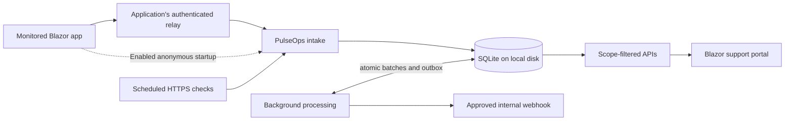
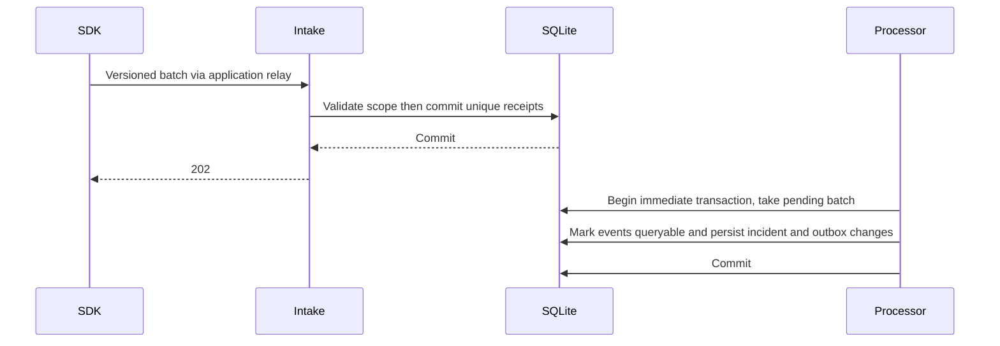
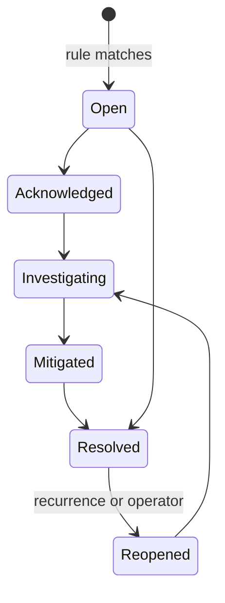

# PulseOps architecture

The .NET 10 platform is a modular monolith. `PulseOps.Server` serves a standalone Blazor WASM build, query and ingestion endpoints, operational health and a SignalR hub. It runs the background processor by default. On Windows the same publish artifact can run as a dedicated worker service on the same host. `PulseOps.Sdk.Blazor` and its bootstrap script are separately distributed as a Razor Class Library NuGet package. The demo projects provide the instrumented app and fault-injecting API.

## Architecture decisions

| Decision | Consequences |
| --- | --- |
| SQLite for production and development | Simple install and point-in-time backups on local disk. WAL allows readers alongside a writer. A single writer serializes mutations. Keep the database off network shares or distributed volumes. |
| Parameterized Microsoft.Data.Sqlite commands | Explicit immediate transactions, indexed projections, exact nearest-rank percentiles and native backups. Migrations are ordered by SQLite `user_version`. The application fails startup if the schema or bundled engine is incompatible. |
| Combined receipt and processed-event table | No durable queue service and no intermediate payload copy. Marking events processed, updating incidents and inserting outgoing deliveries share a transaction. A worker exit rolls back an incomplete batch. |
| Separate machine and operator trust | Scoped machine bearer tokens stay on approved server-side relays. OIDC drives the operator cookie, server-side roles and exact group-to-scope assignments. Opt-in anonymous startup is constrained and excluded from trusted incident evaluation. |
| Blazor and original SVG time-series | The same scope and time range follow query links. Percentiles use observed request durations. Empty chart buckets carry a null percentile. UI assets are served locally. |
| Rollups committed with receipt state | Hourly and daily UTC rollups and signal activity are written in the same immediate transaction that marks a batch processed, so each event is aggregated exactly once, including the one-time backfill of databases created before rollups. Long-range percentiles come from a mergeable log-scale histogram (about ±2%); raw-window queries stay exact. |
| Fair, fault-isolated processing | Each batch shares capacity across scopes with pending work from a persisted cursor, so one flooding application cannot starve others. A record-specific fault retries the batch one record at a time and quarantines only the failing record as a replayable dead letter; a circuit breaker stops quarantining when faults look systemic. Each worker step is isolated so a fault never stops intake or the host. |
| Scheduled monitors beside window rules | Latency (optionally against an hourly-rollup baseline), no-data and release-regression policies evaluate on a schedule from trusted, processed telemetry with hysteresis and cooldown. Each evaluation reads in a snapshot and commits state, incident, history and outbox together with a compare-and-set guard for concurrent workers. |
| Maker-checker configuration with an append-only audit chain | Monitor policies and maintenance windows change only through proposals that a second platform administrator approves, with optimistic revision checks and expiry. Every proposal, decision and incident change appends to a SHA-256 hash chain that triggers keep append-only. Free text stays out of the chain so it can be redacted; exports and the CLI verify the full chain. |
| Ordered outbox with maintenance deferral | Deliveries for one incident and destination leave in order with a monotonic sequence. Maintenance defers new alerts until the window ends instead of dropping them, and a resolution reaches every destination that was told the incident is open. SMTP and webhooks share the outbox, leases and retry policy. |
| SQLite busy handling | Every connection sets `busy_timeout`, so a brief writer collision waits in SQLite's fine-grained busy handler instead of the client library's 150 ms retry sleep. This removed the ~150 ms intake latency tail measured under concurrent processing. |

## DataCat functional mapping

PulseOps was initially implemented from the product brief. After authorization, the upstream checkout was reviewed at commit `c016efb70de792f5beeb7b2d1266830087910343`. PulseOps translates the upstream Boolean search compiler to C# and SQLite with allowlisted fields and bound parameters, adapts its monitoring recovery threshold for consecutive fully observed windows, and ports its mergeable log-scale latency histogram for rollups. The host, storage, UI and SDK are a .NET rewrite for the specified environment. Attribution is in `third_party/datacat`. [DataCat source and product README](https://github.com/replit/datacat/tree/c016efb70de792f5beeb7b2d1266830087910343)

| Public DataCat capability | PulseOps coverage |
| --- | --- |
| Metrics explorer, dashboards | Request, failure, session, startup and latency summary with scoped charts and metrics, plus long-range hourly/daily history from rollups. The rollup histogram adapts DataCat's APM stats histogram. Formulas and persisted layouts are pending. |
| Log search and trace correlation | Bounded Boolean event search and correlation by trace/session. Materialized text logs and arbitrary attributes are outside the telemetry policy. |
| Service catalog and traces | Configured applications, dependency summary, trace and span links using client observations. Internal SAP activity requires backend instrumentation. |
| Monitor policies and notifications | Failure-rate windows with recovery thresholds, scheduled latency (with optional historical baseline), no-data and release-regression monitors, maintenance windows that defer alerts, and an ordered durable outbox for scoped HTTPS webhooks and SMTP e-mail. Anomaly models beyond baselines and escalation schedules are pending. |
| Organizations and intake credentials | Enterprise SSO, five roles, group-to-application/environment mapping, scoped machine tokens, an emergency per-scope intake kill switch, and maker-checker change control with a hash-chained, exportable audit log. |
| Agent and wire compatibility | Native Blazor NuGet/bootstrap and versioned JSON intake. Datadog and OTLP agent wire protocols are pending. |
| Blazor-specific features | Pre-runtime startup monitoring, browser performance signals, navigation, fail-open operation timing and finance workflow sample. |

Dashboard scope and operational chart conventions were informed by the public documentation. [Datadog widget configuration](https://docs.datadoghq.com/dashboards/widgets/configuration/) · [Splunk chart options](https://help.splunk.com/en/splunk-observability-cloud/create-dashboards-and-charts/create-charts/chart-options-in-the-chart-builder)
