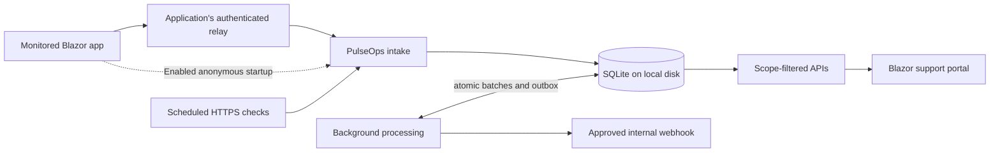
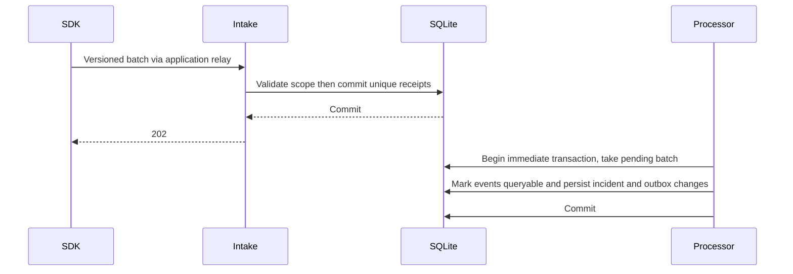
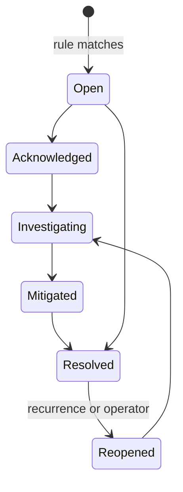

# PulseOps architecture

The .NET 10 platform is a modular monolith. `PulseOps.Server` serves a standalone Blazor WASM build, query and ingestion endpoints, operational health and a SignalR hub. It runs the background processor by default. On Windows the same publish artifact can run as a dedicated worker service on the same host. `PulseOps.Sdk.Blazor` and its bootstrap script are separately distributed as a Razor Class Library NuGet package. The demo projects provide the instrumented app and fault-injecting API.

## Architecture decisions

| Decision | Consequences |
| --- | --- |
| SQLite for production and development | Simple install and point-in-time backups on local disk. WAL allows readers alongside a writer. A single writer serializes mutations. Keep the database off network shares or distributed volumes. |
| Parameterized Microsoft.Data.Sqlite commands | Explicit immediate transactions, indexed projections, exact nearest-rank percentiles and native backups. Migrations are ordered by SQLite `user_version`. The application fails startup if the schema or bundled engine is incompatible. |
| Combined receipt and processed-event table | No durable queue service and no intermediate payload copy. Marking events processed, updating incidents and inserting outgoing deliveries share a transaction. A worker exit rolls back an incomplete batch. |
| Separate machine and operator trust | Scoped machine bearer tokens stay on approved server-side relays. OIDC drives the operator cookie, server-side roles and exact group-to-scope assignments. Opt-in anonymous startup is constrained and excluded from trusted incident evaluation. |
| Blazor and original SVG time-series | The same scope and time range follow query links. Percentiles use observed request durations. Empty chart buckets carry a null percentile. UI assets are served locally. |

## DataCat functional mapping

PulseOps was initially implemented from the product brief. After authorization, the upstream checkout was reviewed at commit `c016efb70de792f5beeb7b2d1266830087910343`. PulseOps translates the upstream Boolean search compiler to C# and SQLite with allowlisted fields and bound parameters, and adapts its monitoring recovery threshold for consecutive fully observed windows. The host, storage, UI and SDK are a .NET rewrite for the specified environment. Attribution is in `third_party/datacat`. [DataCat source and product README](https://github.com/replit/datacat/tree/c016efb70de792f5beeb7b2d1266830087910343)

| Public DataCat capability | PulseOps coverage |
| --- | --- |
| Metrics explorer, dashboards | Request, failure, session, startup and latency summary with scoped charts and metrics. Formulas and persisted layouts are pending. |
| Log search and trace correlation | Bounded Boolean event search and correlation by trace/session. Materialized text logs and arbitrary attributes are outside the telemetry policy. |
| Service catalog and traces | Configured applications, dependency summary, trace and span links using client observations. Internal SAP activity requires backend instrumentation. |
| Monitor policies and notifications | Configurable failure and recovery windows, grouped incident history, and durable scoped HTTPS webhook delivery. Broader anomaly rules and other notification adapters are pending. |
| Organizations and intake credentials | Enterprise SSO, five roles, group-to-application/environment mapping and scoped machine tokens. |
| Agent and wire compatibility | Native Blazor NuGet/bootstrap and versioned JSON intake. Datadog and OTLP agent wire protocols are pending. |
| Blazor-specific features | Pre-runtime startup monitoring, browser performance signals, navigation, fail-open operation timing and finance workflow sample. |

Dashboard scope and operational chart conventions were informed by the public documentation. [Datadog widget configuration](https://docs.datadoghq.com/dashboards/widgets/configuration/) · [Splunk chart options](https://help.splunk.com/en/splunk-observability-cloud/create-dashboards-and-charts/create-charts/chart-options-in-the-chart-builder)
