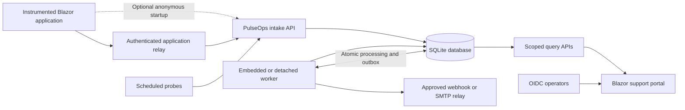
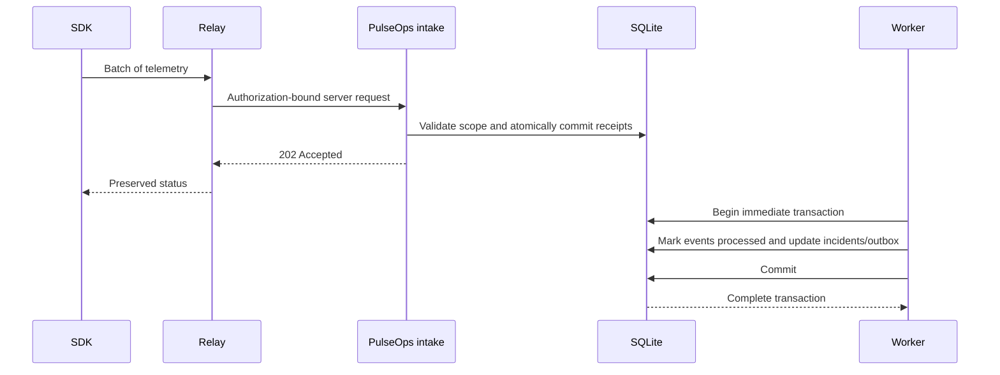

# PulseOps

PulseOps is a self-hosted .NET 10 observability workbench for standalone Blazor WebAssembly applications and their dependencies. It provides browser startup monitoring, HTTP and business-operation telemetry, session and trace drill-down, incident detection and recovery, and operator triage.

The standard deployment is a single ASP.NET Core process that serves the API, standalone Blazor portal, ingestion endpoints, health endpoints and optional embedded background worker. SQLite is the only application database and uses local filesystem storage.

Repository: <https://github.com/MaxRecursion/PulseOps>

## Quick start

From the repository root on macOS or Linux, start a labeled local demo with .NET 10 and a fresh SQLite database.

```sh
dotnet restore PulseOps.sln --locked-mode
dotnet build PulseOps.sln -c Release --no-restore
demo_dir=$(mktemp -d)
ASPNETCORE_ENVIRONMENT=Development PulseOps__Demo=true PulseOps__DatabasePath="$demo_dir/pulseops.db" \
  dotnet run --project src/PulseOps.Server -c Release --no-build --no-launch-profile -- --urls http://localhost:5080
```

Open the [dashboard](http://localhost:5080/) once [readiness](http://localhost:5080/health/ready) returns `{"status":"ready"}`. SQLite is included. The dashboard can be explored immediately. To generate an incident, start the sample in a second terminal, open the [finance workspace](http://localhost:5091/) and run the **HTTP 503** scenario.

```sh
ASPNETCORE_ENVIRONMENT=Development \
  dotnet run --project samples/PulseOps.Demo.Api -c Release --no-build --no-launch-profile -- --urls http://localhost:5091
```

Use the [PowerShell and step-by-step setup](#step-by-step-local-setup) on Windows. The [operator handbook](docs/PulseOps-Operator-Guide.docx) covers first use, production installation, monitoring and recovery. The [Windows runbook](docs/Operations.md) contains the protected configuration and deployment commands.

## Feature overview

- Dashboard, dependencies, incidents, sessions, traces, exceptions and structured event views
- Scoped application and environment filtering
- Browser startup milestones and startup failure observations
- Browser navigation, HTTP, operation, error, session and Web Vitals telemetry
- Windowed failure incident detection with automatic recovery
- Incident acknowledgement, investigation, mitigation, resolution and reopening
- OIDC authentication, role-based authorization and exact group-to-scope mapping
- Machine-scoped telemetry intake for approved server-side relays
- SQLite WAL, migrations, retention, durable intake receipts and native backup/restore
- Durable notification outbox for scoped HTTPS webhooks and SMTP
- Hourly and daily UTC history, latency, no-data and release-regression monitors
- Approved policy changes, maintenance windows and hash-chained audit export
- Standalone Blazor WebAssembly SDK and early browser bootstrap
- Instrumented finance demo with success and fault scenarios
- Optional detached Windows worker process

See [Implementation Status](IMPLEMENTATION_STATUS.md) for delivered scope and known limitations.

## Technology stack

| Component | Technology |
| --- | --- |
| Runtime | .NET 10 / ASP.NET Core 10 |
| Portal | Standalone Blazor WebAssembly |
| Server | ASP.NET Core modular monolith |
| Database | SQLite through Microsoft.Data.Sqlite |
| Identity | OIDC/PKCE and ASP.NET Core cookies |
| SDK | Blazor Razor Class Library and browser bootstrap JavaScript |
| Tests | NUnit, bUnit and Playwright |
| Windows deployment | Windows Service or optional IIS |

Dependency versions are pinned centrally in [Directory.Packages.props](Directory.Packages.props).

## Architecture





For detailed implementation decisions, see [ARCHITECTURE.md](ARCHITECTURE.md).

## Repository layout

```text
.
├── src/
│   ├── PulseOps.Server/       ASP.NET Core host, intake, storage and processing
│   ├── PulseOps.Portal/       Standalone Blazor WebAssembly operator portal
│   └── PulseOps.Sdk.Blazor/   Blazor instrumentation package and bootstrap
├── samples/
│   ├── PulseOps.Demo.Blazor/  Instrumented finance demo application
│   └── PulseOps.Demo.Api/     Loopback-only relay and fault simulation API
├── tests/
│   ├── PulseOps.Tests/        NUnit and bUnit unit/component tests
│   └── PulseOps.EndToEndTests/Playwright end-to-end tests
├── deployment/
│   ├── windows/               Windows Service/IIS deployment scripts
│   └── teamcity/              Build and Artifactory guidance
├── docs/                      Operations, SDK, security and support guides
└── artifacts/                 Generated local build or release output
```

## Prerequisites

### Local development

- Git
- .NET 10 SDK `10.0.404` or a later stable feature band
- PowerShell 7, optional for cross-platform scripts
- macOS, Linux or Windows
- Chromium, optional for Playwright end-to-end tests

Confirm the SDK version:

```bash
dotnet --info
```

The repository's [global.json](global.json) pins SDK `10.0.404` and allows the latest compatible feature roll-forward.

### Windows production

- Supported Windows Server release
- .NET 10 ASP.NET Core Runtime `10.0.15` or later .NET 10 servicing release
- Trusted TLS certificate
- Local NTFS storage
- Enterprise OIDC provider
- Native PowerShell 7.4 or later

Production requirements and scripts are documented in [docs/Operations.md](docs/Operations.md).

## Step-by-step local setup

### 1. Clone the repository

```bash
git clone https://github.com/MaxRecursion/PulseOps.git
cd PulseOps
```

### 2. Restore from locked package manifests

```bash
dotnet restore PulseOps.sln --locked-mode
```

Package lock files and central package versions are used for repeatable restores.

### 3. Build all projects

```bash
dotnet build PulseOps.sln --no-restore
```

### 4. Run the unit and component tests

```bash
dotnet test PulseOps.sln --no-build
```

The Playwright suite may require an independently published host and installed browser runtime. It is not the default local smoke test.

### 5. Start PulseOps in demo mode

Set the environment to Development and enable the explicitly labeled demo:

**macOS/Linux**

```bash
ASPNETCORE_ENVIRONMENT=Development PulseOps__Demo=true \
  dotnet run --project src/PulseOps.Server --no-build --no-launch-profile -- --urls http://localhost:5080
```

**PowerShell**

```powershell
$env:ASPNETCORE_ENVIRONMENT = 'Development'
$env:PulseOps__Demo = 'true'
dotnet run --project src/PulseOps.Server --no-build --no-launch-profile -- --urls http://localhost:5080
```

On startup in Development, PulseOps creates or migrates `src/PulseOps.Server/data/pulseops.db` by default. The embedded worker is enabled by default.

Open the following endpoints:

- PulseOps portal: <http://localhost:5080/>
- Live health: <http://localhost:5080/health/live>
- Ready health: <http://localhost:5080/health/ready>

Development demo mode creates a local operator identity for UI testing. Demo mode must not be used for production.

### 6. Start the instrumented demo application

In a second terminal:

**macOS/Linux**

```bash
ASPNETCORE_ENVIRONMENT=Development \
  dotnet run --project samples/PulseOps.Demo.Api --no-build --no-launch-profile -- \
  --urls http://localhost:5091
```

**PowerShell**

```powershell
$env:ASPNETCORE_ENVIRONMENT = 'Development'
dotnet run --project samples/PulseOps.Demo.Api --no-build --no-launch-profile -- --urls http://localhost:5091
```

The demo API serves the Blazor application and authenticated loopback relay.

Open <http://localhost:5091/>.

## Run the local demo workflow

1. Open PulseOps at <http://localhost:5080/>.
2. Open the finance demo at <http://localhost:5091/>.
3. Generate a successful report.
4. Generate an HTTP 503 report.
5. In PulseOps, select `finance-demo` and the `demo` environment.
6. Inspect the generated incident and follow it into the session and trace.
7. Acknowledge, investigate, mitigate or resolve the incident.
8. Open <http://localhost:5091/boot-failure.html> to verify startup-failure handling. Anonymous startup evidence is restricted and excluded from trusted incident evaluation.
9. Stop PulseOps and run another report to verify the SDK and relay fail open.

## Configuration

The server reads configuration in this precedence order:

1. `appsettings.json`
2. Environment-specific `appsettings.{Environment}.json`
3. An optional `--config` JSON file
4. Environment variables
5. Command-line arguments

Use `PulseOps__Section__Name` for environment variables. For example:

```bash
PulseOps__DatabasePath=/path/to/pulseops.db
PulseOps__EmbeddedWorker=true
PulseOps__Demo=false
```

The default [src/PulseOps.Server/appsettings.json](src/PulseOps.Server/appsettings.json) contains:

```json
{
  "Logging": {
    "LogLevel": {
      "Default": "Information",
      "Microsoft.AspNetCore": "Warning"
    }
  },
  "PulseOps": {
    "DatabasePath": "data/pulseops.db",
    "EmbeddedWorker": true,
    "Demo": false,
    "RetentionDays": 14,
    "IncidentRetentionDays": 180,
    "InboxMaximum": 100000,
    "MinimumFreeMegabytes": 512
  }
}
```

Important options include:

| Option | Purpose |
| --- | --- |
| `PulseOps:DatabasePath` | SQLite database path |
| `PulseOps:EmbeddedWorker` | Run the processor in the web process |
| `PulseOps:Demo` | Enable local demo data and operator behavior |
| `PulseOps:RetentionDays` | Event retention period |
| `PulseOps:IncidentRetentionDays` | Incident retention period |
| `PulseOps:InboxMaximum` | Maximum accepted backlog |
| `PulseOps:MinimumFreeMegabytes` | Free-disk guard threshold |
| `PulseOps:Auth` | OIDC authority, client and claim settings |
| `PulseOps:Scopes` | Application/environment scope and ingest authorization |
| `PulseOps:Rules` | Windowed failure detection policies |
| `PulseOps:Monitors` | Scheduled latency, no-data and release comparisons |
| `PulseOps:RollupHourlyDays` / `RollupRetentionDays` | UTC hourly and daily history windows |
| `PulseOps:ErrorRetentionDays` | Optional exception-event retention |
| `PulseOps:DataProtectionPath` | Persistent ASP.NET Data Protection keys |

Never place OIDC secrets or machine ingest tokens in source control or public configuration. Use host environment variables or a protected production configuration file.

## SQLite database operations

For a disposable local database, set `PulseOps__DatabasePath` to its absolute path in this shell before running these commands. For production, use the Windows wrapper and protected configuration described in the recovery guide. Stop all database users before restoring and verify the snapshot first.

```bash
# Apply migrations
dotnet run --project src/PulseOps.Server --no-launch-profile -- --migrate

# Create a native SQLite backup
dotnet run --project src/PulseOps.Server --no-launch-profile -- --backup /absolute/path/pulseops-backup.db

# Verify a backup
dotnet run --project src/PulseOps.Server --no-launch-profile -- --verify-backup /absolute/path/pulseops-backup.db

# Restore a backup
dotnet run --project src/PulseOps.Server --no-launch-profile -- --restore /absolute/path/pulseops-backup.db
```

Use local NTFS or equivalent local filesystem storage. Do not place SQLite on a network share or distributed volume. Back up and restore only through the application commands or a coordinated database snapshot procedure.

## Run the worker separately

The web process runs the embedded worker by default. To run a detached worker, configure `PulseOps:EmbeddedWorker=false` in the web process and start worker mode against the same database:

```bash
ASPNETCORE_ENVIRONMENT=Development \
  dotnet run --project src/PulseOps.Server --no-build --no-launch-profile -- --worker
```

In a Windows deployment, the same executable can be registered as a second worker service. Both processes must use the same database and a one-host deployment boundary.

## Publish a release

### Cross-platform framework-dependent publish

```bash
dotnet publish src/PulseOps.Server/PulseOps.Server.csproj \
  -c Release \
  --no-restore \
  -o artifacts/dist/PulseOps
```

### Windows x64 publish

```bash
dotnet publish src/PulseOps.Server/PulseOps.Server.csproj \
  -c Release \
  -r win-x64 \
  --self-contained false \
  -o artifacts/dist/PulseOps-win-x64
```

The server publish includes the standalone portal build and relevant third-party notices.

## Pack the Blazor SDK

```bash
dotnet pack src/PulseOps.Sdk.Blazor/PulseOps.Sdk.Blazor.csproj \
  -c Release \
  --no-restore \
  -o artifacts/nuget
```

The package version is `0.1.0` from [Directory.Build.props](Directory.Build.props).

For consuming application setup, package use and browser bootstrap instructions, see [docs/SDK.md](docs/SDK.md).

## Windows deployment

PulseOps provides Windows deployment and recovery tooling for a dedicated Windows Server:

1. Provision .NET 10 ASP.NET Core Runtime, PowerShell 7.4 and local NTFS storage.
2. Install a trusted TLS certificate.
3. Register a confidential OIDC web client.
4. Verify the release manifest digest obtained from your trusted build record and verify each file before staging.
5. Create protected `appsettings.Production.json` configuration.
6. Validate and migrate the database.
7. Register the Windows Service or IIS application.
8. Start the service and verify live and ready health endpoints.
9. Configure an application-specific relay and scoped machine credential.

Start with [docs/Operations.md](docs/Operations.md). That guide includes private configuration examples, ACL handling, database migration, backup/restore, Windows Service recovery and IIS deployment.

Production configuration must include:

- Exact HTTPS host and certificate
- Persistent SQLite path
- Persistent Data Protection key path
- Enterprise OIDC authority and confidential client
- Exact role and group claim names
- Application/environment scopes
- Distinct ingest token per scope
- Explicit incident rules
- TLS-bound HTTPS health probes

Never expose machine ingest credentials to browser JavaScript.

## Testing

Run the complete solution tests:

```bash
dotnet test PulseOps.sln --no-build
```

Run one test project directly:

```bash
dotnet test tests/PulseOps.Tests/PulseOps.Tests.csproj
```

The test project covers server restart behavior, concurrent idempotence, scoped authorization, atomic backpressure, validation, Boolean search, webhook leasing, recovery thresholds and SQLite restore behavior. bUnit covers portal loading and error states.

The Playwright project contains opt-in Chromium scenarios. It requires its browser runtime and a published Release host:

```bash
dotnet build tests/PulseOps.EndToEndTests/PulseOps.EndToEndTests.csproj
dotnet test tests/PulseOps.EndToEndTests/PulseOps.EndToEndTests.csproj --no-build
```

## Health and troubleshooting

| Problem | Check |
| --- | --- |
| Server does not start | SDK/runtime version, database path, migrations and private configuration |
| Ready health fails | SQLite integrity, free disk space, schema version and worker state |
| Login redirects fail | OIDC authority, redirect URI, client secret and certificate |
| User sees no data | Role claim, group claim and exact `Scopes` application/environment match |
| Ingest is rejected | Scope token, application/environment, body limit and metadata allowlist |
| Database is locked | Network storage, abandoned process, WAL configuration or excessive concurrent writers |
| Demo is not visible | Development environment, `PulseOps__Demo=true`, loopback URL and demo relay process |
| Worker stops silently | Logs, SQLite writable directory and inbox/backlog limits |

Health endpoints:

- `/health/live` verifies process liveness.
- `/health/ready` verifies readiness, storage and schema state.

In production, do not treat live-only health as sufficient for load-balancer routing.

## Documentation

- [Architecture](ARCHITECTURE.md)
- [Local performance benchmark](docs/Performance.md)
- [Windows operations and recovery](docs/Operations.md)
- [Staging acceptance and capacity tests](docs/Staging.md)
- [Blazor SDK integration](docs/SDK.md)
- [Telemetry and storage contract](docs/Telemetry.md)
- [Security threat model](docs/Security.md)
- [Support investigation guide](docs/Support.md)
- [TeamCity and Artifactory](deployment/teamcity/README.md)
- [Dependencies](docs/Dependencies.md)
- [Implementation status and rollout limitations](IMPLEMENTATION_STATUS.md)

## Security and privacy

PulseOps excludes raw payloads, browser identifiers, identity attributes, HTTP headers, URL parameters and query strings from telemetry. Use the SDK's allowlisted endpoint and operation aliases. All browser telemetry should pass through an authenticated same-origin relay in production. Machine credentials must remain server-side.

Before production rollout, complete HTTPS certificate validation, OIDC claim and deprovisioning testing, ACL review, backup and restore rehearsal, capacity testing and security acceptance. Demo configuration and synthetic data do not establish production readiness.
